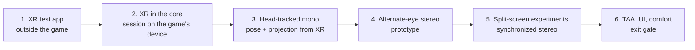

# Phase 1: Stereo viewer

**Exit gate (from the design doc):** 30 minutes in the headset with a gamepad, correct stereo, no TAA smear.

Phase 0 gave us full control of the gameplay camera's pose at the source (the camera entity's Transform), a confirmed hook site for the projection, and the head hidden from the main view. Phase 1 turns that into a head-tracked stereo image in an OpenXR headset.

## Test hardware

Meta Quest 2 through SteamVR (Quest Link / Air Link or Steam Link), so the OpenXR runtime is SteamVR's. Expect a recommended per-eye size around 1832×1920 at 100% render scale, refresh 72/80/90/120 Hz (aim for 72 or 90 with reprojection), and Touch controllers (capacitive touch, no finger tracking). The encoder adds latency over a wireless link, so judge comfort on a cable first.

## Plan

### 1. OpenXR test app (no game)
- `tools/xr_test`: create an instance with `XR_KHR_D3D11_enable`, get the HMD system, create a D3D11 device on the adapter OpenXR asks for, a session, a swapchain per eye, and run a frame loop that clears each eye to a test pattern.
- **Gate:** test pattern visible in the headset on SteamVR.
- Status 2026-10-12: built (`build\vs2026\bin\RelWithDebInfo\bg3vr_xr_test.exe`, loader fetched and verified by `tools/fetch-openxr.ps1`). `--probe` reaches the runtime (SteamVR/OpenXR 2.17.10) and reports no headset, exit code 2, since none was connected. Next: run `bg3vr_xr_test --probe`, then `bg3vr_xr_test --seconds 30`, with the headset on.

### 2. OpenXR inside the core
- Get the game's `ID3D11Device` and swapchain. The Script Extender already Detours-hooks `D3D11CreateDevice`, `CreateSwapChainForHwnd`, `Present` and `ResizeBuffers`, so prefer a vtable hook on the swapchain object (taken from our own `Present` observation) over inline-patching the same functions.
- The game's device must be on the adapter the runtime requires (`xrGetD3D11GraphicsRequirementsKHR`); log and fail clearly if not.
- Frame loop: `xrWaitFrame` / `xrBeginFrame` before the game starts rendering the frame, `xrEndFrame` after our copy at `Present`. Where to call `xrWaitFrame` (game thread vs a pacing thread) is the first design decision of this step.
- **Gate:** the game runs with an XR session open; the desktop image is copied into both eyes as a flat screen.

### 3. Head-tracked mono
- Each frame: `xrLocateViews` → head pose → convert from OpenXR (right-handed, −Z forward) to the game (left-handed, +Z forward) → write into the camera Transform via the existing `camera_view_update` hook, anchored at the character's eye position.
- Hook `camera_set_projection_call` and build the asymmetric projection from `XrFovf` in the game's reversed-Z form (see [re-notes/stereo.md](re-notes/stereo.md)).
- Set the game's render resolution and aspect to the headset's recommended per-eye size.
- **Gate:** looking around in the headset moves the view with no lag you can see; the horizon stays level.

### 4. Alternate-eye stereo (prototype)
- Even frames render the left eye's pose and projection, odd frames the right; each frame is copied to its eye's swapchain image; both images are submitted every frame.
- Expect ghosting in motion and TAA history mixing between eyes. Measure, don't fix yet.
- **Gate:** correct depth when standing still.

### 5. Split-screen experiments (toward synchronized stereo)
- The PC build contains the full split-screen pipeline (`ecl::splitscreen::*`, two render views with `PerCamera` blocks). Try the input event `ToggleForceSplitscreen` and the global `ForceSplitscreen`; find out whether a second view needs a second player entity.
- If two views render in one frame, drive each view's camera to one eye: that is synchronized stereo with no ghosting.
- **Gate:** a decision: split screen as the stereo path, or stay with alternate-eye plus mitigations.

### 6. TAA, UI and comfort → exit gate
- TAA: per-eye history, or turn TAA off in VR (check the game's settings first).
- UI: Phase 1 accepts the game UI baked into the eye image; separating it is Phase 3.
- Comfort: lock the horizon, recentre on a button, fade on teleports and loading screens.
- RenderDoc capture (carried over from Phase 0 step 7) to map the passes, TAA and the UI pass.

## Decisions for this phase

- Alternate-eye first, split screen as the target (step 5 decides).
- Where `xrWaitFrame` runs.
- Bridge: [ADR 0002](decisions/0002-native-lua-bridge.md).

## Risks

| Risk | Mitigation |
| --- | --- |
| Our D3D11 hooks conflict with the Script Extender's | Hook different points (swapchain vtable); test with the extender's ImGui overlay on |
| Game device on the wrong adapter for the headset | Check at session creation; document the GPU requirement |
| `xrWaitFrame` blocking stalls the game thread | Call it on a pacing thread and hand frames over |
| Alternate-eye ghosting is unbearable | Go straight to step 5; or reprojection |
