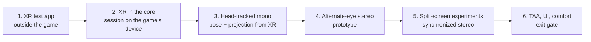

# Phase 1: Stereo viewer

**Exit gate (from the design doc):** 30 minutes in the headset with a gamepad, correct stereo, no TAA smear.

Phase 0 gave us full control of the gameplay camera's pose at the source (the camera entity's Transform), a confirmed hook site for the projection, and the head hidden from the main view. Phase 1 turns that into a head-tracked stereo image in an OpenXR headset.

## Test hardware

Meta Quest 2 through SteamVR (Quest Link / Air Link or Steam Link), so the OpenXR runtime is SteamVR's. Expect a recommended per-eye size around 1832×1920 at 100% render scale, refresh 72/80/90/120 Hz (aim for 72 or 90 with reprojection), and Touch controllers (capacitive touch, no finger tracking). The encoder adds latency over a wireless link, so judge comfort on a cable first.

## Plan

### 1. OpenXR test app (no game)
- `tools/xr_test`: create an instance with `XR_KHR_D3D11_enable`, get the HMD system, create a D3D11 device on the adapter OpenXR asks for, a session, a swapchain per eye, and run a frame loop that clears each eye to a test pattern.
- **Gate:** test pattern visible in the headset on SteamVR.
- Status 2026-10-12: built (`build\vs2026\bin\RelWithDebInfo\bg3vr_xr_test.exe`, loader fetched and verified by `tools/fetch-openxr.ps1`). `--probe` reaches the runtime (SteamVR/OpenXR 2.17.10) and reports no headset, exit code 2, since none was connected. Next, with the headset on: `bg3vr_xr_test --probe`, then `--seconds 30` (eye FOV and IPD printed), then `--quad --seconds 30` (a pulsing red checkerboard on a 3 m screen 2.5 m ahead: the same copy-to-quad path the game uses).

### 2. OpenXR inside the core
- Get the game's `ID3D11Device` and swapchain. The Script Extender already Detours-hooks `D3D11CreateDevice`, `CreateSwapChainForHwnd`, `Present` and `ResizeBuffers`, so prefer a vtable hook on the swapchain object (taken from our own `Present` observation) over inline-patching the same functions.
- The game's device must be on the adapter the runtime requires (`xrGetD3D11GraphicsRequirementsKHR`); log and fail clearly if not.
- Frame loop: `xrWaitFrame` / `xrBeginFrame` before the game starts rendering the frame, `xrEndFrame` after our copy at `Present`. Where to call `xrWaitFrame` (game thread vs a pacing thread) is the first design decision of this step.
- **Gate:** the game runs with an XR session open; the desktop image is copied into both eyes as a flat screen.
- Progress 2026-10-13:
    - `native/xr` (`bg3vr_xr`): instance, headset and session on a caller-supplied device, shared with `bg3vr_xr_test`.
    - The game's Present call found statically in `rf::dx11::RenderFrame::FlipBuffers` (`dx11_present_call`). `native/core/src/render.cpp` hooks it there, upstream of DXGI and of the Script Extender's own Present detour. It logs the device and back buffer and counts frames; its present callback is where the copy into the eye images will go.
    - The flat-screen mirror, `native/core/src/headset.cpp`, built and deployed, off by default (`[xr] enabled = false`). On the first present it loads `openxr_loader.dll` from `bin\bg3vr` (delay-loaded, so the core runs without it), opens the instance, checks that the game's adapter LUID matches the runtime's, creates the session on the game's device and a quad swapchain the size of the back buffer, in the sRGB form of its format (the back buffer bytes are gamma-encoded). Every present after that: poll events, `xrWaitFrame`/`xrBeginFrame`, copy the back buffer into the quad image, `xrEndFrame` with one quad layer, 3 m wide and 2.5 m ahead in LOCAL space (`screen_width_m`, `screen_distance_m`).
    - Decision for the prototype: `xrWaitFrame` runs on the game's render thread, in the present callback. The game is then paced by the headset (72/90 Hz), which is what we want for the mirror. Revisit in step 3, where the pose has to be known before the game builds its view.
    - Untested with a headset. Test order: `bg3vr_xr_test --quad`, then the game with SteamVR running and `[xr] enabled = true` (log lines start `xr:`).

### 3. Head-tracked mono
- Each frame: `xrLocateViews` → head pose → convert from OpenXR (right-handed, −Z forward) to the game (left-handed, +Z forward) → write into the camera Transform via the existing `camera_view_update` hook, anchored at the character's eye position.
- Hook `camera_set_projection_call` and build the asymmetric projection from `XrFovf` in the game's reversed-Z form (see [re-notes/stereo.md](re-notes/stereo.md)). Done 2026-10-13 (untested in game): `vr::projection`, `vr::from_openxr` and `vr::anchor` in `native/core/src/vr_math.cpp` with unit tests, and the projection hook with `!vr_cam_eye left|right|off` for a desktop check.
- Set the game's render resolution and aspect to the headset's recommended per-eye size.
- Built 2026-10-13, untested with a headset: `[xr] mode = mono`. Each Present, `headset.cpp` locates the views for when the *next* frame will be displayed (`predictedDisplayTime + period × (1 + lag)`) and hands the camera a centre-eye view whose field of view covers both eyes (`camera::set_head`). While a pose is held, the camera's view update writes `anchor(held pose, from_openxr(view))` (position × `world_scale`) into the Transform, sets the projection from that field of view in the same update, and records the applied view with its view matrix (a history of 8).
- The image presented now was rendered from an *earlier* camera update (the render thread lags the game thread). To submit each image with the pose it was really rendered with, `headset.cpp` looks for the recorded view matrices inside the RenderFrame being presented (`rdi` at the Present call), first by searching its first 0x8000 bytes, then at the offset found. If that never matches, it assumes a lag of 1; `[xr] lag` or `!vr_xr_lag 0..7|auto` overrides. Check in the log: `xr: found the rendered view matrix at RenderFrame+0x...`, and the report line `rendered view matched / unmatched / assumed`.
- Then the back buffer is copied into both eye images and submitted as a projection layer with that view for both eyes. No pose held: the virtual screen instead.
- **Gate:** looking around in the headset moves the view with no lag you can see; the horizon stays level.

### 4. Alternate-eye stereo (prototype)
- Even frames render the left eye's pose and projection, odd frames the right; each frame is copied to its eye's swapchain image; both images are submitted every frame.
- Expect ghosting in motion and TAA history mixing between eyes. Measure, don't fix yet.
- Built 2026-10-13, untested with a headset: `[xr] mode = alternate`. Same path as mono, but the head view alternates between the left and right eye's pose and field of view each Present, and each image goes to the eye it was rendered for. The other eye keeps its last image and pose, and the compositor reprojects it.
- **Gate:** correct depth when standing still.

### 5. Split-screen experiments (toward synchronized stereo)
- The PC build contains the full split-screen pipeline (`ecl::splitscreen::*`, two render views with `PerCamera` blocks). Try the input event `ToggleForceSplitscreen` and the global `ForceSplitscreen`; find out whether a second view needs a second player entity.
- If two views render in one frame, drive each view's camera to one eye: that is synchronized stereo with no ghosting.
- **Gate:** a decision: split screen as the stereo path, or stay with alternate-eye plus mitigations.

### 6. TAA, UI and comfort → exit gate
- TAA: per-eye history, or turn TAA off in VR (check the game's settings first).
- UI: Phase 1 accepts the game UI baked into the eye image; separating it is Phase 3.
- Comfort: lock the horizon, recentre on a button, fade on teleports and loading screens.
- RenderDoc capture (carried over from Phase 0 step 7) to map the passes, TAA and the UI pass.

## Decisions for this phase

- Alternate-eye first, split screen as the target (step 5 decides).
- Where `xrWaitFrame` runs.
- Bridge: [ADR 0002](decisions/0002-native-lua-bridge.md).

## Risks

| Risk | Mitigation |
| --- | --- |
| Our D3D11 hooks conflict with the Script Extender's | Hook different points (swapchain vtable); test with the extender's ImGui overlay on |
| Game device on the wrong adapter for the headset | Check at session creation; document the GPU requirement |
| `xrWaitFrame` blocking stalls the game thread | Call it on a pacing thread and hand frames over |
| Alternate-eye ghosting is unbearable | Go straight to step 5; or reprojection |
| The game culls with its own symmetric frustum, not our per-eye projection | Watch the edges of view for popping; if so, find where `FrustumPoints` are built and widen them |
| Back buffer aspect (16:9 window) differs from the eye's (about 1:1) | Geometry is still right (the whole image maps to the eye's field of view), but horizontal resolution is wasted and the UI is squashed; run the game windowed at about the per-eye size |
| The rendered view isn't inline in the RenderFrame | Fall back to a fixed lag (`!vr_xr_lag`); tune by turning your head: the world should not swim |
